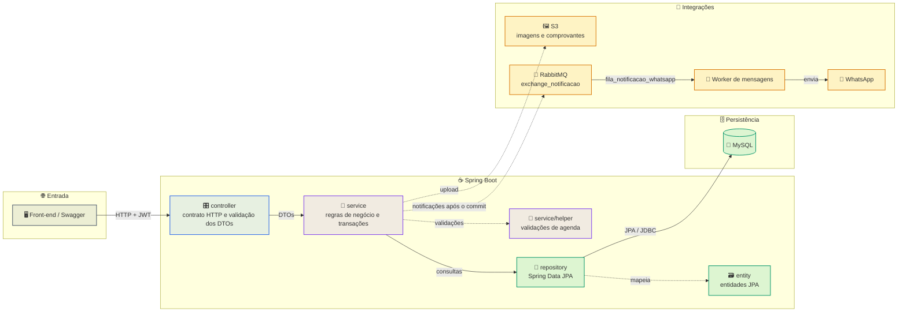
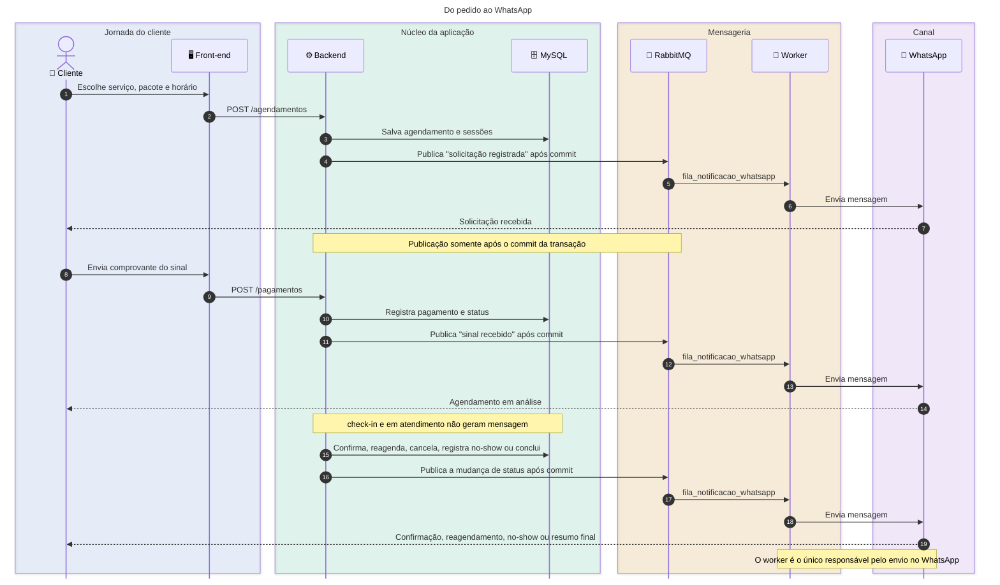
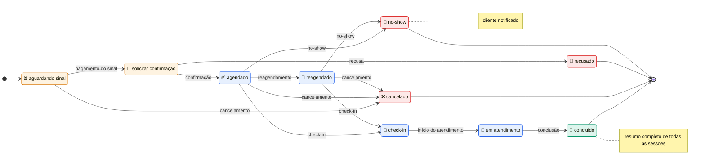

# Studio Essência - Backend

API REST do Studio Essência, responsável por autenticação, cadastro de clientes e profissionais, catálogo de serviços e pacotes, agenda, pagamentos, fichas de anamnese, análise gerencial e notificações de agendamento.

## Sumário

- [Visão geral](#visão-geral)
- [Stack](#stack)
- [Arquitetura](#arquitetura)
- [Diagrama de sequência](#diagrama-de-sequência)
- [Regras de agendamento](#regras-de-agendamento)
- [Notificações](#notificações)
- [Banco de dados](#banco-de-dados)
- [Como executar](#como-executar)
- [Testes](#testes)
- [API e documentação](#api-e-documentação)
- [Variáveis de ambiente](#variáveis-de-ambiente)
- [Segurança](#segurança)

## Visão geral

O Backend é uma aplicação Spring Boot stateless autenticada por JWT. Os
principais fluxos são:

- cadastro, login, recuperação de senha por OTP e desativação de conta;
- gestão de clientes, profissionais, serviços, categorias e pacotes;
- disponibilidade, criação, confirmação, check-in, atendimento, conclusão,
  reagendamento, cancelamento, recusa e registro de `no-show`;
- upload de comprovantes de pagamento e confirmação do sinal;
- fichas de anamnese;
- indicadores e análise de agendamentos;
- publicação de mensagens de WhatsApp no RabbitMQ para o worker de mensagens.

## Stack

| Item | Versão / tecnologia |
| --- | --- |
| Java | 21 |
| Spring Boot | 4.0.6 |
| Spring Security | JWT stateless, BCrypt |
| Persistência | Spring Data JPA / Hibernate |
| Banco principal | MySQL 8 |
| Banco de testes | H2 em memória (escopo de teste) |
| Mensageria | RabbitMQ (Spring AMQP) |
| Armazenamento | AWS S3 para imagens/comprovantes |
| Documentação | Springdoc OpenAPI / Swagger UI |
| Build | Maven Wrapper |

## Arquitetura



- `controller`: contrato HTTP e validação dos DTOs.
- `service`: regras de negócio e transações.
- `repository`: consultas Spring Data JPA.
- `entity`: modelo persistente.
- `dto`: entrada e saída da API.
- `mapper`: conversão entre entidades e DTOs.
- `config`: segurança, S3 e topologia do RabbitMQ.
- `service/helper`: validações compartilhadas de agenda.

A autenticação usa um filtro JWT e não mantém sessão no servidor. As roles
canônicas são `ROLE_ADMIN`, `ROLE_PROFISSIONAL` e `ROLE_CLIENTE`.

## Diagrama de sequência

O caminho abaixo mostra a criação do agendamento, o pagamento do sinal e a
publicação das mensagens. O ponto central é que o Backend só publica no RabbitMQ
depois que a transação de negócio é confirmada.



<details>
<summary><strong>Ver matriz de eventos e mensagens</strong></summary>

| Evento | Status resultante | Mensagem ao cliente |
| --- | --- | --- |
| Criação da solicitação | `aguardando sinal` | Solicitação registrada e instrução para o sinal |
| Pagamento do sinal | `solicitar confirmacao agendamento` | Sinal recebido e horário em análise |
| Confirmação pela equipe | `agendado` | Agendamento confirmado |
| Reagendamento de uma sessão | `reagendado` | Nova data e horário da sessão |
| Cancelamento | `cancelado` | Cancelamento e motivo, quando informado |
| Recusa | `recusado` | Solicitação não confirmada |
| No-show | `no-show` | Registro de ausência e convite para remarcar |
| Conclusão | `concluido` | Resumo do pacote, todas as sessões, profissional e valor total |
| Check-in / em atendimento | `check-in` / `em atendimento` | Sem mensagem |

</details>

## Regras de agendamento

O status fica em `status_agendamentos` e é a fonte única para os indicadores.
Os estados operacionais são:

| Estado | Significado |
| --- | --- |
| `aguardando sinal` | solicitação criada, aguardando comprovante de sinal |
| `solicitar confirmacao agendamento` | comprovante recebido, aguardando análise |
| `agendado` | horário confirmado |
| `reagendado` | sessão alterada; no painel é apresentado como agendado |
| `check-in` | cliente chegou ao studio |
| `em atendimento` | atendimento iniciado |
| `concluido` | atendimento finalizado |
| `cancelado` | cancelamento com motivo e data |
| `recusado` | solicitação recusada pela equipe |
| `no-show` | cliente não compareceu |

<details>
<summary><strong>Ver máquina de estados do agendamento</strong></summary>



</details>

Regras implementadas:

- `check-in` e `em atendimento` exigem perfil `ROLE_ADMIN` ou
  `ROLE_PROFISSIONAL`; o profissional só altera a própria agenda.
- `no-show` só pode ser registrado em agendamento `agendado` ou `reagendado`.
- estados terminais (`concluido`, `cancelado`, `recusado`, `no-show`) bloqueiam
  novas alterações.
- cancelamento pelo cliente exige pelo menos 24 horas de antecedência;
  administradores podem cancelar fora desse prazo.
- o reagendamento aceita o `itemId` da sessão, atualiza a data, incrementa
  `qtd_remarcacoes`, grava o status `reagendado` e notifica o cliente.
- a validação de conflito de horário considera todas as sessões do pacote e
  ignora o próprio agendamento quando a operação é um reagendamento.
- os contadores de no-show são calculados diretamente pelo status, sem campo
  duplicado no cliente.

## Notificações

As mensagens são publicadas pelo Backend no RabbitMQ e entregues pelo worker
[`Essencia-schedulling-message`](../Essencia-schedulling-message). O Backend não envia WhatsApp diretamente.

Fluxo:

```text
mudança de status -> NotificacaoAgendamentoService
                  -> publica após o commit em exchange_notificacao
                  -> fila_notificacao_whatsapp
                  -> worker -> WAHA / Twilio / NoOp
```

Mensagens enviadas ao cliente:

- solicitação criada;
- pagamento/sinal recebido (`solicitar confirmacao agendamento`);
- confirmação (`agendado`);
- reagendamento;
- cancelamento e recusa;
- `no-show`;
- conclusão, com resumo do pacote, todas as sessões, profissional e valor total.

`check-in` e `em atendimento` não geram mensagem. Solicitações de cancelamento ou
reagendamento só notificam depois que a equipe toma uma decisão. Se a publicação no broker falhar, a alteração de status permanece confirmada e o erro é registrado em log.

<details>
<summary><strong>Ver exemplo de payload publicado no RabbitMQ</strong></summary>

```json
{
  "numero": "5511999999999",
  "mensagem": "Olá, Ana! Seu agendamento está confirmado.\n\nPacote: ...",
  "parametros": {}
}
```

O worker valida o número, resolve placeholders e entrega a mensagem pelo
provedor configurado. O Backend não envia WhatsApp diretamente.

</details>

## Banco de dados

O MySQL é a referência do projeto. O schema, os dados de referência e a agenda
de demonstração estão em:

```text
src/main/resources/db/init.sql
```

Esse é o único script SQL do Backend:

- cria as tabelas com `CREATE TABLE IF NOT EXISTS`;
- usa `INSERT IGNORE` para dados de referência e demonstração;
- padroniza o status `no-show` (bancos antigos com `faltou` são atualizados);
- deve ser executado por um usuário com permissão de DDL.

Para executá-lo no primeiro boot ou em um banco limpo, use MySQL e desative a
criação automática de schema do Hibernate para que o script seja a fonte única
da estrutura:

```text
SPRING_SQL_INIT_MODE=always
SPRING_SQL_INIT_DATA_LOCATIONS=classpath:db/init.sql
SPRING_JPA_DDL_AUTO=none
```

Por padrão, o `application.properties` aponta para MySQL, usa
`SPRING_JPA_DDL_AUTO=none` e executa `db/init.sql` no boot. O H2 fica no escopo
de teste, em `src/test/resources/application.properties`, com schema gerado pelo Hibernate; não existe um segundo script SQL. Em produção, mantenha
`SPRING_JPA_DDL_AUTO=none`, `SPRING_SQL_INIT_MODE=always` e migrações versionadas para evoluções de schema.

O script não substitui uma ferramenta de migração: `CREATE TABLE IF NOT EXISTS`
não altera tabelas já existentes. Para mudanças estruturais em produção, aplique uma migração antes de subir a nova versão da aplicação.

Contas de demonstração criadas pelo script (senha `Studio@123`):

| E-mail | Perfil |
| --- | --- |
| `admin@studioessencia.com` | administrador |
| `profissional@studioessencia.com` | profissional |
| `cliente@studioessencia.com` | cliente |
| `maria@studioessencia.com` | cliente |

## Como executar

Pré-requisitos:

- Java 21;
- MySQL 8;
- RabbitMQ 4 se quiser testar notificações;
- credenciais AWS se quiser testar upload em S3.

O H2 é usado apenas pelos testes automatizados e não é necessário para executar a aplicação.

Crie o banco e um usuário MySQL, por exemplo:

```sql
CREATE DATABASE studioessencia CHARACTER SET utf8mb4 COLLATE utf8mb4_unicode_ci;
CREATE USER 'studioEssencia'@'localhost' IDENTIFIED BY 'uma-senha-forte';
GRANT ALL PRIVILEGES ON studioessencia.* TO 'studioEssencia'@'localhost';
FLUSH PRIVILEGES;
```

No PowerShell:

```powershell
$env:SPRING_DATASOURCE_URL = "jdbc:mysql://localhost:3306/studioessencia?useSSL=false&allowPublicKeyRetrieval=true&serverTimezone=America/Sao_Paulo"
$env:SPRING_DATASOURCE_DRIVER_CLASS_NAME = "com.mysql.cj.jdbc.Driver"
$env:SPRING_DATASOURCE_USERNAME = "studioEssencia"
$env:SPRING_DATASOURCE_PASSWORD = "uma-senha-forte"
$env:SPRING_SQL_INIT_MODE = "always"
$env:SPRING_JPA_DDL_AUTO = "none"
$env:JWT_SECRET = "uma-chave-base64-com-pelo-menos-32-bytes"
$env:RABBITMQ_USERNAME = "usuario-do-backend"
$env:RABBITMQ_PASSWORD = "senha-do-usuario"

.\mvnw.cmd spring-boot:run
```

Para gerar e executar o JAR:

```powershell
.\mvnw.cmd -q -DskipTests package
java -jar target/web-backend-0.0.1-SNAPSHOT.jar
```

Se o RabbitMQ não estiver disponível, a API pode iniciar, mas as notificações
não serão publicadas. A aplicação registra a falha sem desfazer a transação de
negócio.

## Testes

```powershell
.\mvnw.cmd test
```

Os testes de contexto e de serviço usam H2 em memória. O schema é gerado pelo
Hibernate a partir das entidades; o script MySQL não é executado nos testes.

Cobertura principal:

- regras de cancelamento e permissões;
- confirmação, recusa e `no-show`;
- conteúdo das notificações, incluindo o resumo de conclusão;
- serviços, profissionais e usuários;
- criação do contexto Spring.

## API e documentação

Com a aplicação em execução:

- Swagger UI: `http://localhost:8080/swagger-ui.html`
- OpenAPI JSON: `http://localhost:8080/v3/api-docs`

Principais grupos de endpoints:

| Prefixo | Responsabilidade |
| --- | --- |
| `/usuarios` | cadastro, login, perfil, clientes, profissionais, horários e bloqueios |
| `/servicos` | catálogo, categorias, pacotes e upload de imagens |
| `/agendamentos` | criação, disponibilidade, status, reagendamento e comprovante |
| `/pagamentos` | upload do comprovante de sinal |
| `/fichas` | anamnese |
| `/analise` | indicadores de agendamentos |

Exemplos de transições:

```http
PATCH /agendamentos/{id}/confirmar
PATCH /agendamentos/{id}/checkIn
PATCH /agendamentos/{id}/emAtendimento
PATCH /agendamentos/{id}/concluido
PATCH /agendamentos/{id}/no-show
PATCH /agendamentos/{id}/recusar
PATCH /agendamentos/{itemId}/reagendar?novoHorario=2026-11-10T09:00:00
```

## Variáveis de ambiente

| Variável | Padrão | Uso |
| --- | --- | --- |
| `SPRING_DATASOURCE_URL` | `jdbc:mysql://localhost:3306/studioessencia?...` | URL JDBC do MySQL |
| `SPRING_DATASOURCE_DRIVER_CLASS_NAME` | `com.mysql.cj.jdbc.Driver` | driver JDBC |
| `SPRING_DATASOURCE_USERNAME` | `root` | usuário do banco |
| `SPRING_DATASOURCE_PASSWORD` | vazio | senha do banco |
| `SPRING_JPA_DDL_AUTO` | `none` | Hibernate não cria o schema; use `none` com o script SQL |
| `SPRING_SQL_INIT_MODE` | `always` | executa `db/init.sql` no boot; use `never` para desativar |
| `SPRING_SQL_INIT_DATA_LOCATIONS` | `classpath:db/init.sql` | script de schema/dados |
| `JWT_SECRET` | chave de exemplo | chave de assinatura JWT |
| `JWT_VALIDITY` | `3600` | validade do token em segundos |
| `RABBITMQ_HOST` | `localhost` | host do RabbitMQ |
| `RABBITMQ_PORT` | `5672` | porta AMQP |
| `RABBITMQ_USERNAME` | `admin` | usuário do RabbitMQ |
| `RABBITMQ_PASSWORD` | `admin` | senha do RabbitMQ |
| `OTP_VALIDADE_MINUTOS` | `5` | validade do código OTP |
| `OTP_MAX_TENTATIVAS` | `5` | tentativas do OTP |
| `OTP_RESET_TOKEN_VALIDADE_MINUTOS` | `10` | validade do token de redefinição |
| `CORS_ALLOWEDORIGINS` | `http://localhost:5173` | origens permitidas, separadas por vírgula |

A configuração de S3 (`aws.s3.*`) está em `application.properties` e deve ser
ajustada ao bucket do ambiente. Não coloque credenciais AWS no repositório; use
o instance profile ou variáveis do ambiente.

## Segurança

- Troque `JWT_SECRET` e as credenciais de demonstração em qualquer ambiente
  compartilhado.
- Restrinja o RabbitMQ a uma rede privada e use um usuário exclusivo para o
  Backend.
- Configure CORS com as origens reais do Front-end.
- O script de demonstração contém dados e senhas conhecidas; não o use como
  base para produção.
- Não versione arquivos de ambiente, chaves privadas ou credenciais AWS.
